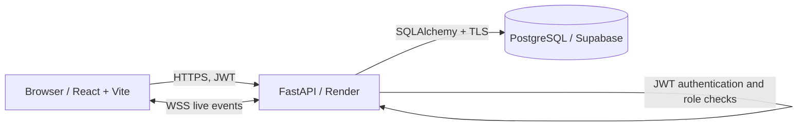

# StudySync

**A real-time collaborative workspace for students and study groups.**

StudySync brings modules, shared task boards, comments and activity history into one place. Team members can organise coursework, assign tasks, track progress and see updates live without refreshing the page.

**Live app:** [StudySync](https://studysync-979i9yzrb-raialiyan.vercel.app)  
**Backend health:** [API status](https://studysync-api-t5tz.onrender.com/health)

> **Deployment note:** The live-app link above is a verified working deployment from November 2026, not necessarily the permanent Vercel domain. Replace it with your canonical **Production** domain from Vercel → Domains before finalising your portfolio.

## What it does

- **Secure accounts:** Register, sign in and access protected routes using JWT authentication and password hashing.
- **Shared workspaces:** Create study spaces, add members and manage access using role-aware permissions.
- **Modules:** Organise work into persistent study modules within a workspace.
- **Collaborative task tracking:** Create, assign and update tasks, including task status changes.
- **Comments and activity:** Discuss tasks and review recorded changes.
- **Live updates:** WebSocket events notify connected workspace members when tasks or comments change.
- **Responsive interface:** React dashboard, workspace management, task board, redesigned authentication screens and empty states.

## Tech stack

| Layer | Technology |
| --- | --- |
| Frontend | React, Vite, CSS, React Router |
| Backend | Python, FastAPI, SQLAlchemy, Pydantic |
| Authentication | JWT, Argon2id password hashing |
| Data | PostgreSQL, Alembic migrations |
| Real-time | WebSockets |
| Local deployment | Docker Compose, nginx |
| Cloud deployment | Vercel (frontend), Render (API), Supabase (PostgreSQL) |
| Testing | Pytest integration tests and automated deployment smoke tests |

## Architecture



For details, see [Architecture and engineering decisions](docs/ARCHITECTURE.md).

## Verified behaviour

The implementation was checked at multiple levels during development:

- **14 / 14** isolated backend integration tests passed.
- **17 / 17** Docker end-to-end smoke checks passed.
- **18 / 18** public cloud production smoke checks passed on **14 November 2026**. These checks covered registration and login, JWT protection, workspace isolation, member privileges, modules, persistence, tasks, comments, activity and two authenticated WebSocket connections receiving events.
- Login was subsequently verified in the redesigned web UI after correcting the production CORS origin.

These are point-in-time test results, not a claim of exhaustive security, accessibility or browser compatibility testing.

## Running locally

### Requirements

- Docker Desktop with Docker Compose
- A private `.env.docker` file based on `docker.env.example`

The repository includes `compose.yaml`, frontend and backend Dockerfiles and a template for environment variables.

```bash
cp docker.env.example .env.docker
```

Fill in the placeholders in `.env.docker` with your own strong local secrets. **Never commit this file.** For a brand-new Docker database only:

```bash
docker compose --env-file .env.docker up -d db
docker compose --env-file .env.docker run --rm backend python -m alembic upgrade head
docker compose --env-file .env.docker up -d --build
```

Access the frontend at `http://localhost:5173` and the API at `http://localhost:8000/health`.

> Migration commands are intended for newly initialised databases. Do not apply a baseline migration to an existing schema without first checking its Alembic state.

Stop the stack without removing its database volume:

```bash
docker compose --env-file .env.docker down
```

## Production deployment

The React/Vite frontend is served by Vercel, FastAPI runs on Render, and the PostgreSQL database is hosted on Supabase. The frontend uses `VITE_API_URL` and `VITE_WS_URL`; the backend uses `DATABASE_URL`, `JWT_SECRET_KEY` and `ALLOWED_ORIGINS`.

See [Deployment and security notes](docs/DEPLOYMENT.md) for environment variable guidance, the permanent-domain checklist and appropriate safeguards. **Never commit production secrets.**

## Project write-up

See [Portfolio case study and CV bullets](docs/PORTFOLIO.md) for a concise technical walkthrough suitable for software engineering applications.

## Current limitations and potential improvements

- Hosted free services may experience cold starts, sleep or resource limits.
- The WebSocket broadcast implementation is intended for a single running API process; scaling to multiple workers would require shared pub/sub infrastructure.
- Automated checks don't replace comprehensive security review, threat modelling, accessibility testing and cross-browser verification.
- Potential next steps include richer task views, improved notifications, CI checks and observability.

## Author

Rai Muhammad Aliyan — Computer Science student at the University of Manchester.
