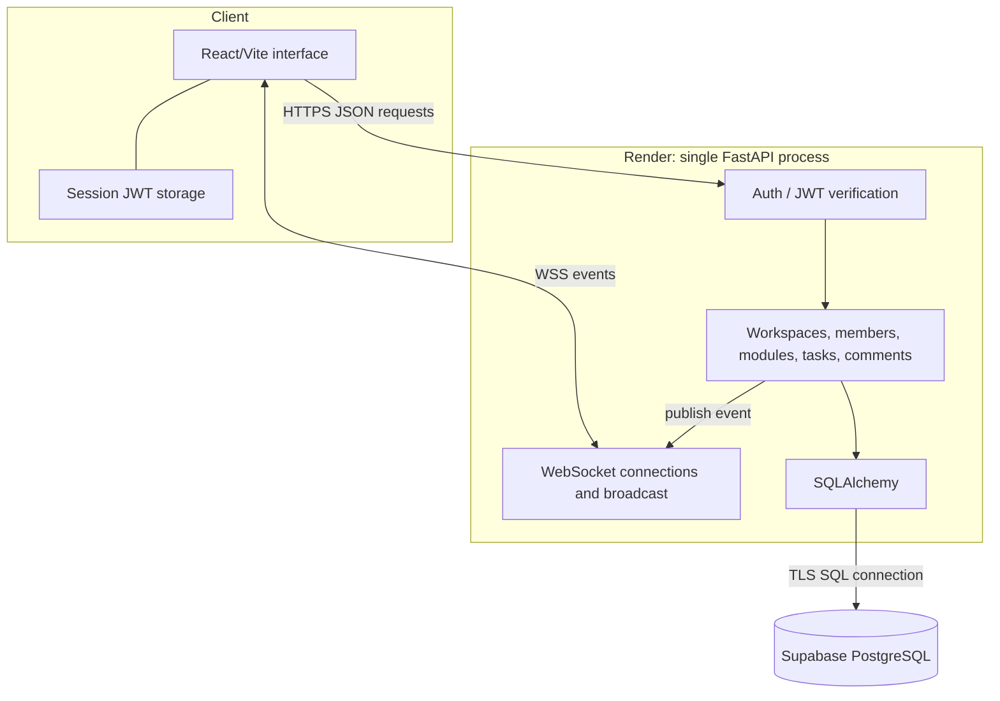

# StudySync — Architecture and technical design

## System overview

## Data and permission model

The backend persists accounts, workspaces, workspace members, modules, tasks, comments and activity records in PostgreSQL. JWT-based authentication identifies the requesting user. The workspace membership and ownership checks restrict access to shared data; an unauthorised user cannot freely retrieve another workspace's records or perform owner-only membership changes.

The production smoke suite exercised outsider isolation, owner-only permissions, comment ownership and task assignee validation. These are automated behavioural checks, not a full formal security audit.

## Collaboration flow

1. A signed-in member creates or updates a task through the HTTPS API.
2. FastAPI validates authentication, membership and input.
3. SQLAlchemy persists the change in PostgreSQL.
4. A WebSocket event is emitted to connected, authorised clients.
5. The clients refresh the relevant view to show the persisted state.

The application is currently suitable for a single active API process. A multi-instance architecture would require a shared message broker for fan-out across processes.

## Deployment

| Component | Development | Hosted |
| --- | --- | --- |
| UI | Vite dev server / nginx container | Vercel |
| API | FastAPI / Docker | Render |
| Data | Dedicated Docker PostgreSQL volume | Supabase PostgreSQL |
| Schema | Alembic | Alembic migration at deployment |

Production and local databases are separate. Never run an initial baseline migration against an unverified existing database.

## Testing evidence

- 14/14 isolated Pytest integration tests passed.
- 17/17 Docker smoke tests passed.
- 18/18 cloud production smoke checks passed, including real WebSocket events delivered to two authenticated connections.
- Browser sign-in was subsequently confirmed after a CORS configuration correction.

## Trade-offs

**Advantages:** straightforward Python and React architecture; PostgreSQL data durability; clear auth boundaries; fast real-time UX; reproducible local containers.

**Constraints:** Render free instance cold starts; WebSocket state held per server process; no established multi-region or multi-worker scale; no claim of formal penetration testing, comprehensive accessibility auditing or production SLAs.
